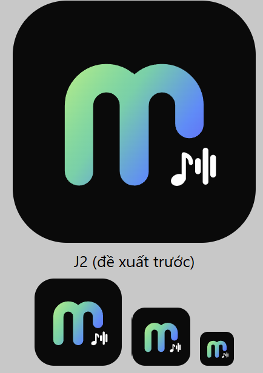

<div align="center">
  
  <h1>MinMusic</h1>
  <h3>Trình nghe nhạc tất cả trong một cho Android: YouTube Music, SoundCloud, Zing MP3 và NhacCuaTui</h3>
  <p><i>An all-in-one music player for Android (phone and tablet): stream, download in the best quality, and tune with a Poweramp-class equalizer. No ads, no telemetry.</i></p>

  <a href="https://github.com/nev-minhnh/MinMusic/releases/latest"></a>
  <a href="LICENSE"></a>
  <a href="https://github.com/nev-minhnh/MinMusic/releases"></a>
</div>

<br>

> [!WARNING]
> Việc dùng ứng dụng bên thứ ba để truy cập YouTube Music, Zing MP3, NhacCuaTui hay SoundCloud có thể vi phạm điều khoản dịch vụ của các nền tảng đó. Bạn tự chịu trách nhiệm khi sử dụng; nên dùng một tài khoản Google phụ.

## Tính năng

**Nguồn nhạc**
- 4 nguồn trong một app: **YouTube Music**, **SoundCloud**, **Zing MP3**, **NhacCuaTui**. Kết quả tìm kiếm, bảng xếp hạng (cuộn xem đầy đủ) và hàng chờ trộn được nhiều nguồn.
- **Tự chọn nguồn chất lượng cao nhất** cho cùng một bài, có cơ chế tạm ngắt nguồn đang lỗi.
- **Tài khoản VIP của chính bạn:** Zing MP3 (đăng nhập qua WebView) và NhacCuaTui (mật khẩu chỉ dùng khi đăng nhập, không bao giờ được lưu; token được mã hoá) để mở 320 kbps và lossless. Mặc định không đăng nhập là 128 kbps. MinMusic **không** vượt rào VIP, DRM hay bản nghe thử SoundCloud Go+.

**Tải nhạc chất lượng cao**
- Tải luồng tốt nhất có thể (YouTube: Opus 251), **không chuyển mã**, ghi đủ tag và ảnh bìa (ID3v2, FLAC, Vorbis).
- Tự chọn thư mục lưu, gộp bài đã tải thành **album của riêng bạn**.

**Âm thanh**
- **EQ toàn màn hình** kiểu Poweramp: parametric 64-bit, nhiều loại bộ lọc, preset theo từng thiết bị phát, xuất cấu hình Equalizer APO, cùng các hiệu ứng tone, crossfeed…

**Lời bài hát**
- Lời chạy theo nhạc từ nhiều nguồn, **ưu tiên đúng bài**: kiểm tra tên bài, nghệ sĩ và thời lượng. Không chắc chắn thì không hiện, thay vì hiện lời của bài khác. Bài Zing/NCT ưu tiên lời gốc của nguồn đó.

**Giao diện**
- Thiết kế "Sân khấu tối", màu thương hiệu mặc định, có tuỳ chọn Material You.
- Cuộn và chuyển cảnh mượt; chọn bài là trình phát mở toàn màn hình; tuỳ biến kiểu thanh tiến trình, độ dày, kiểu mini player.
- **Tablet dọc và ngang:** thanh rail/sidebar, thanh phát nhạc gắn đáy hoặc nổi (có nút tắt), trình phát có tab Lời / Tiếp theo / Liên quan, hộp thoại giữa màn hình khi màn rộng.
- Nút Back lùi từng lớp; bấm Back 2 lần liên tiếp mới thoát app.

**Kết nối**
- **Device Connect:** dùng điện thoại hoặc tablet điều khiển MinMusic trên máy tính qua mạng LAN hoặc VPN (Tailscale, OpenVPN…). Ghép đôi bằng mã hoặc QR, không cần tài khoản Google.
- Kế thừa từ Metrolist: Listen Together, cast tới Google Cast / DLNA, nhận diện bài hát, Last.fm, ListenBrainz, Discord, nhập playlist và sao lưu.

**Riêng tư**
- **Không quảng cáo, không bao giờ.** Không có SDK quảng cáo hay theo dõi; bản build tự kiểm tra và chặn nếu có.
- **Không thu thập dữ liệu:** đã gỡ hoàn toàn Sentry.

## Tải về

| Nền tảng | Tải | Ghi chú |
|---|---|---|
| **Android** (điện thoại + tablet) | [MinMusic.apk – bản mới nhất](https://github.com/nev-minhnh/MinMusic/releases/latest) | Android 7.0 trở lên. Một file APK cho cả điện thoại và tablet. Kiểm tra file bằng `MinMusic.apk.sha256` |
| **Windows** 10/11 (bản Compose) | [Các bản `windows-v*`](https://github.com/nev-minhnh/MinMusic/releases?q=windows&expanded=true) | Bộ cài hoặc bản portable. Chưa ký số nên SmartScreen có thể cảnh báo: chọn *More info → Run anyway* |
| **Windows** bản mới (Tauri + WebView2) | [MinMusic_For_Windows](https://github.com/nev-minhnh/MinMusic_For_Windows) | Đang phát triển: giao diện mượt như Edge, dùng chung lõi với bản Android |

Chứng chỉ ký APK (SHA-256): `77:D3:62:7B:…:92:D4`. Các bản cập nhật luôn dùng cùng chứng chỉ, nên cài đè không mất dữ liệu.

## Lịch sử phiên bản

| Phiên bản | Nội dung chính |
|---|---|
| **1.0.4** | Tablet: nút menu không còn bị thanh phát nhạc che; thêm nút tắt thanh phát nhạc; thanh nằm sát cạnh dưới |
| **1.0.3** | Logo màu; thanh phát nhạc tablet khi xoay ngang không bị cắt; kiểu mini player áp dụng trên tablet; điện thoại xoay ngang trở lại như 1.0.1; lời bài hát ưu tiên đúng bài |
| **1.0.2** | Giao diện tablet dọc và ngang; Device Connect điều khiển máy tính |
| **1.0.1** | Trình phát tự mở toàn màn hình; tôn trọng mọi cài đặt giao diện; viền mờ ảnh bìa; lời bài hát ưu tiên bản chạy chữ; bảng xếp hạng cuộn đầy đủ; nút Back lùi từng lớp |
| **1.0.0** | Bản đầu tiên: 4 nguồn nhạc, tải chất lượng cao, EQ toàn màn hình, thiết kế mới, bỏ quảng cáo và theo dõi |

## Build từ mã nguồn

Yêu cầu JDK 21 và Android SDK.

```bash
git clone https://github.com/nev-minhnh/MinMusic.git
cd MinMusic
./gradlew :androidApp:assembleDebug          # APK debug: androidApp/build/outputs/apk/debug/
./gradlew :androidApp:testDebugUnitTest :shared:desktopTest
```

Bản phát hành có chữ ký được build trên GitHub Actions khi gắn tag `vX.Y.Z`. Tài liệu cho nhà phát triển nằm trong [docs/](docs/README.md).

## Ghi công

MinMusic là bản fork của **[Metrolist](https://github.com/MetrolistGroup/Metrolist)**, xin cảm ơn đội ngũ Metrolist và các dự án mà Metrolist sử dụng:
[InnerTubeX](https://github.com/MetrolistGroup/innertubex) (YouTube),
[NewPipe Extractor](https://github.com/TeamNewPipe/NewPipeExtractor) (SoundCloud),
[MusicRecognizer](https://github.com/aleksey-saenko/MusicRecognizer) (nhận diện bài hát),
[metroserver](https://github.com/MetrolistGroup/metroserver) (Listen Together),
cùng các nhà cung cấp lời bài hát LrcLib, KuGou, SimpMusic, BetterLyrics và Paxsenix.

## Giấy phép

Phát hành theo giấy phép **GNU General Public License v3.0**, giống dự án gốc. Xem [LICENSE](LICENSE).

> [!NOTE]
> MinMusic không liên kết với, không được tài trợ hay chứng thực bởi YouTube, Google LLC, VNG (Zing MP3), NCT (NhacCuaTui), SoundCloud hay Metrolist. Mọi nhãn hiệu thuộc về chủ sở hữu tương ứng.
